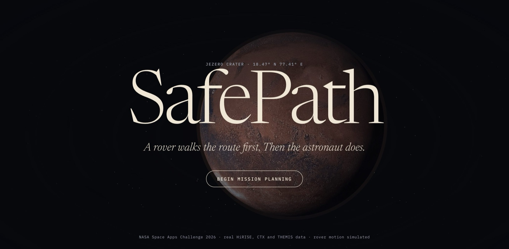
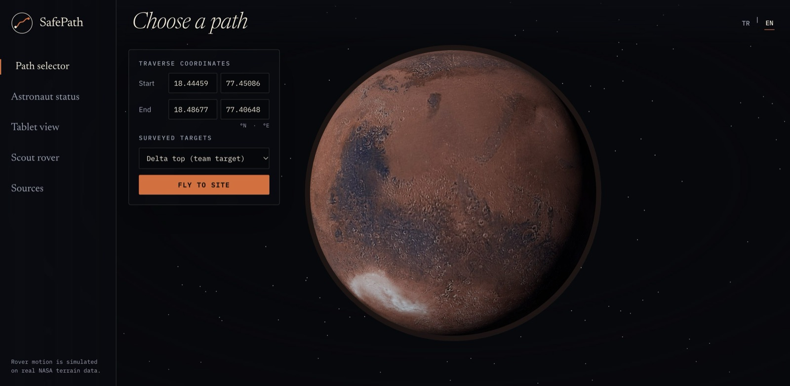
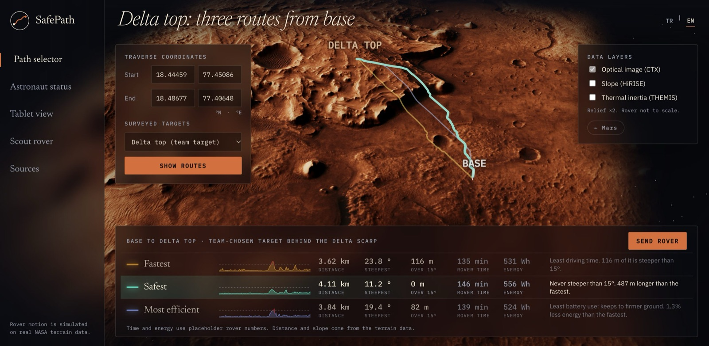
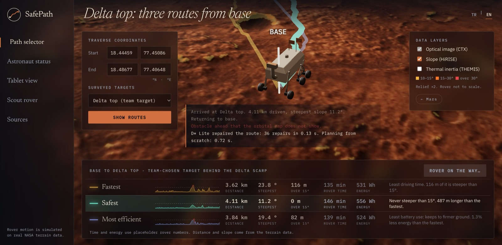
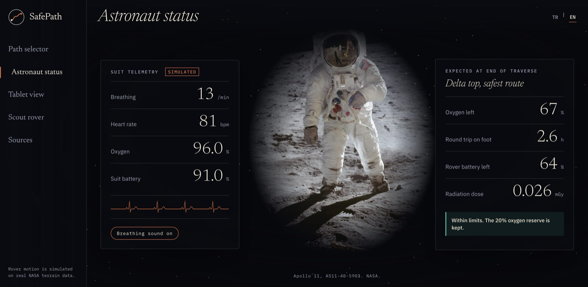
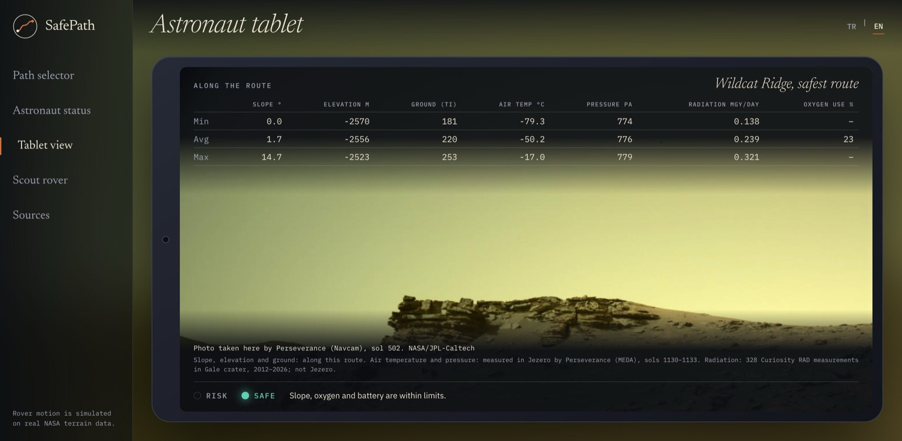
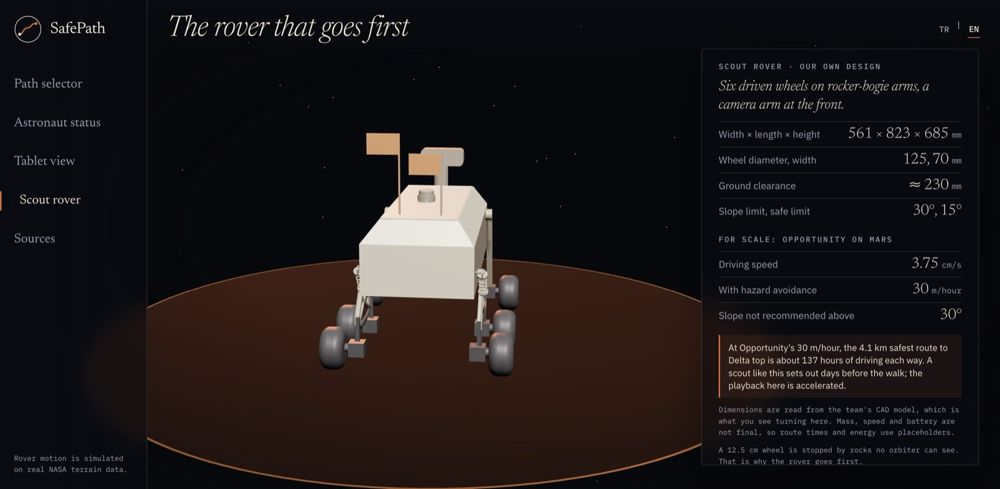
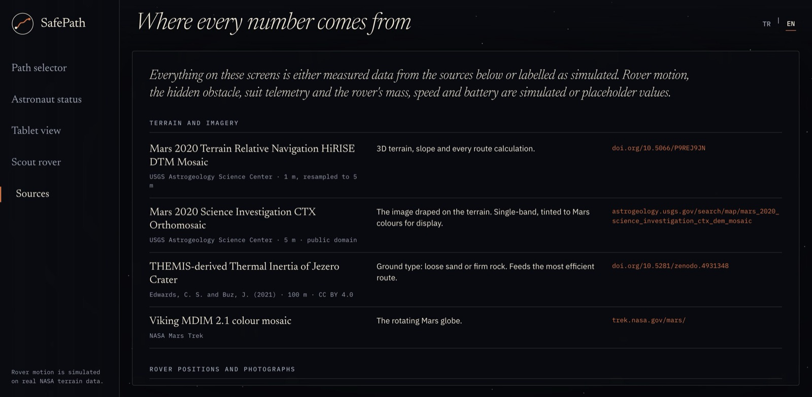

# SafePath

**Rover first, then human.** A layered Mars map and route planner for astronaut
surface exploration in Jezero crater. NASA Space Apps Challenge 2026.

**Live demo: https://aliandacerdass.github.io/NASA_Spaceapp26/**

Türkçe özet: [README.tr.md](README.tr.md)



Before an astronaut walks to a science target, a small scout rover drives the
route first. SafePath computes three routes on real NASA terrain data, checks the
rover's battery and the astronaut's oxygen for the round trip, and repairs the
route with D* Lite when the rover meets an obstacle the orbital map did not show.

## Contents

- [What you see](#what-you-see)
- [How the routes are computed](#how-the-routes-are-computed)
- [Data](#data)
- [Validation](#validation)
- [What is real and what is simulated](#what-is-real-and-what-is-simulated)
- [Run it](#run-it)
- [Repository layout](#repository-layout)
- [Team](#team)
- [Use of AI](#use-of-ai)
- [References](#references)

## What you see

The interface is a static site in `web/`, in English and Turkish. It has five screens.

### 1. Path selector

A rotating Mars globe built from NASA's Viking mosaic. Enter start and end
coordinates or pick a surveyed target, and the globe turns to Jezero and flies in.



The mission area is a 10 x 10 km square of real terrain: HiRISE elevation at 5 m,
the CTX image draped on top, and switchable slope and thermal inertia layers. The
three routes draw themselves from base to target. Each row below shows the slope
profile along the route, distance, steepest slope, distance above the safe limit,
and one sentence on why that route was chosen.



"Send rover" drives the team's scout rover out and back. On the safest route to
the delta top, an obstacle that is not in the orbital data appears on the way
back. The rover only sees the part within sensor range, and D* Lite repairs the
route each time new blocked cells appear.



### 2. Astronaut status

Suit telemetry (simulated, with a synthesized breathing sound) next to what the
selected route leaves at the end of the traverse: oxygen, walking time, rover
battery and radiation dose.



### 3. Tablet view

What the astronaut carries: minimum, average and maximum values along the route,
the air temperature and pressure Perseverance measured in Jezero, Curiosity's
radiation measurements, and a real photograph Perseverance took at the arrival
point. A lamp shows whether the route is within limits.



### 4. Scout rover

The team's own rover design, converted from its CAD model, with the dimensions
read from that model.



### 5. Sources

Every data source, what it is used for, and a link, so each number on screen can
be traced. The AI use statement is on the same screen.



## How the routes are computed

Every 5 m cell has a slope (from elevation) and a ground type (from thermal
inertia). Moves between neighbouring cells get a cost, and D* Lite finds the
cheapest path for each of three profiles:

- **Fastest**: least driving time. The rover slows down on slopes.
- **Safest**: never enters cells steeper than the safe limit (15 degrees).
- **Most efficient**: least battery use. Loose ground costs more energy than firm ground, and sunlit ground gives some back through the solar panel (shadows and sun angle computed from the elevation model for one fixed sun position).

Cells steeper than 30 degrees are impassable for every profile.

Example, landing site to a target on the delta top behind the scarp
(`data/processed/routes.json`):

| Route | Distance | Steepest slope | Distance above the safe limit |
|---|---|---|---|
| Fastest | 3621 m | 23.8 deg | 116 m |
| Safest | 4108 m | 11.2 deg | 0 m |
| Most efficient | 3841 m | 19.4 deg | 82 m |

For the six Perseverance stops the three routes are nearly identical, because
Perseverance itself chose places that can be reached over gentle ground.

**Hidden obstacle.** `route/simulate_return.py` drives the rover back to base on
the safest route (`data/processed/return_scenario.json`):

- planned return 4108 m, driven 4241 m, 36 replans
- all 36 repairs together took about 0.13 s; planning again from scratch at the
  first detection took about 0.72 s on the same laptop

The obstacle is placed by us. Its position, size and the sensor range are
scenario choices, not measurements.

**Where the computing happens.** Routes are computed by the Python engine in
`route/` and stored for seven surveyed targets. The web interface displays those
results; it does not run the planner in the browser. A typed coordinate snaps to
the nearest surveyed target, and the interface says so.

## Data

Mission area: 18.3856 to 18.5543 N, 77.3212 to 77.4990 E, around the western
delta of Jezero crater. The base is the Perseverance landing site.

| Layer | Source | Resolution | Use |
|---|---|---|---|
| Elevation | USGS Astrogeology, Mars 2020 Terrain Relative Navigation HiRISE DTM Mosaic | 1 m, resampled to 5 m | 3D terrain, slope, routing |
| Optical image | USGS Astrogeology, Mars 2020 Science Investigation CTX Orthomosaic | 5 m | Basemap draped on the terrain. Single-band, tinted to Mars colours for display |
| Thermal inertia | Edwards and Buz (2021), THEMIS-derived Thermal Inertia of Jezero Crater | 100 m | Ground type: loose sand or firm rock |
| Rover positions | NASA Mars 2020 mission, localized rover stops | per stop | Science stops, validation |
| Arrival photos | NASA Mars 2020 raw images, Navcam | six frames | Tablet view |
| Weather | NASA Mars 2020 MEDA feed | sols 1130 to 1133 | Air temperature and pressure in Jezero |
| Radiation | NASA PDS, MSL RAD reduced data records | 328 observations, 2012 to 2026 | Dose rate, measured in Gale crater |
| Globe | NASA Mars Trek, Viking MDIM 2.1 colour mosaic | global | Opening globe |

The large source files are not in the repository. `pipeline/build_grid.py` reads
only the mission window of the 1.84 GB elevation mosaic with HTTP range requests
(about 85 MB), and `pipeline/fetch_rad.py` reads only the head of every 15th
daily radiation file (a few MB instead of tens of GB).

## Validation

`pipeline/validate_waypoints.py` compares our grid with the 388 localized stops
of Perseverance inside the mission area (`data/processed/validation.json`):

| Check | Result |
|---|---|
| NASA rover elevation minus our grid | mean -0.01 m, standard deviation 0.18 m, largest 0.86 m |
| Rover tilt recorded by NASA | median 3.6 deg, maximum 20.3 deg |
| Our slope at the same cells | median 3.1 deg, maximum 20.7 deg |

`tests/` checks the D* Lite implementation against Dijkstra on random grids,
including replanning after hidden obstacles appear.

## What is real and what is simulated

| Item | Status |
|---|---|
| Terrain, slope, image, thermal inertia | Real NASA and USGS data |
| Route computation and D* Lite | Real algorithm running on the real data |
| Science stop coordinates and arrival photos | Real Perseverance positions and Navcam frames |
| Air temperature and pressure | Real Jezero measurements (MEDA), four sols |
| Radiation | 328 real Curiosity RAD measurements, but from Gale crater, not Jezero |
| Rover model | The team's own CAD design, drawn larger than life on the map |
| Rover motion and sensing | Simulated |
| Hidden obstacle | Placed by us |
| Rover mass, speed, battery, power use | Placeholders until the rover design is final |
| Thermal inertia to rolling resistance mapping | Placeholder |
| Sun position and solar panel power | Placeholders: one fixed sun, 30 deg above the horizon in the east |
| Crew walking speed, EVA duration, reserve | Sourced, but measured for lunar suits |
| Suit oxygen and battery | Drawn down over the 8 hour suit design duration as the walk time passes |
| Heart rate and breathing | Example values, at rest and walking |
| Playback speed | Accelerated. At Opportunity's 30 m/hour the 4.1 km route is about 137 hours of driving each way |
| Basemap colour | Display tint; the CTX camera records a single band |

Times and energy values depend on the placeholder rover numbers and should not be
quoted as results. Distances and slopes come directly from the data.

## Run it

The interface is live at https://aliandacerdass.github.io/NASA_Spaceapp26/ (published from `web/` on every push).
To open it locally (no build step, no dependencies):

```
python -m http.server 8765 --directory web
```

then visit http://127.0.0.1:8765

Rebuild the data and results:

```
python -m venv .venv && .venv/bin/pip install numpy scipy pillow matplotlib pytest trimesh cascadio
.venv/bin/python pipeline/build_grid.py          # downloads the mission window, about 85 MB
.venv/bin/python -m route.plan_routes
.venv/bin/python -m route.simulate_return
.venv/bin/python pipeline/validate_waypoints.py
.venv/bin/python pipeline/fetch_rad.py           # a few MB, about two minutes
.venv/bin/python pipeline/export_web.py
.venv/bin/python -m pytest
```

The processed grids and results are already in `data/processed/` and `web/data/`,
so the interface and the route scripts run without any download.
`pipeline/export_rover.py` needs the team's CAD file, which is not in the repository.

## Repository layout

```
web/        index.html, styles.css, app.js   the interface
            data/                            terrain, textures, mission.json
            assets/                          rover mesh, NASA photographs
            vendor/                          three.js (MIT)
route/      dstar_lite.py                    D* Lite with replanning
            plan_routes.py                   three routes, battery and oxygen checks
            simulate_return.py               hidden obstacle scenario
pipeline/   build_grid.py                    elevation window and slope grid
            fetch_rad.py                     Curiosity radiation sample
            validate_waypoints.py            check against Perseverance positions
            export_web.py, export_rover.py, export_terrain.py
tests/      D* Lite checked against Dijkstra
data/       processed/ (grids, routes, scenario, validation, radiation)
            layers/ (CTX image, thermal inertia)
docs/       images/ (screenshots)
```

## Team

| Member | Role |
|---|---|
| Ali Andaç Erdaş | Route engine, simulation, integration |
| Aras | Map layers and 3D terrain |
| Hilal | Web interface |
| Taha | Research and presentation |
| Batuhan | Research and presentation |

## Use of AI

AI coding assistants (including Anthropic's Claude) were used to write and review
the code in this repository, to process the data and to search for sources. Team
members decided the concept, checked the outputs and are responsible for the
content. No AI-generated images or video are used: every image is a NASA or USGS
product, or is drawn by code from the data. The repository contains no NASA logos
or brand elements.

## References

- USGS Astrogeology Science Center (2020). Mars 2020 Terrain Relative Navigation
  HiRISE DTM Mosaic. https://doi.org/10.5066/P9REJ9JN
- USGS Astrogeology Science Center. Mars 2020 Science Investigation CTX DEM Mosaic
  and Orthomosaic. Public domain.
  https://astrogeology.usgs.gov/search/map/mars_2020_science_investigation_ctx_dem_mosaic
- Edwards, C. S., and Buz, J. (2021). THEMIS-derived Thermal Inertia of Jezero
  Crater, Mars. Zenodo. CC BY 4.0. https://doi.org/10.5281/zenodo.4931348
- NASA/JPL-Caltech. Mars 2020 Perseverance rover waypoints.
  https://mars.nasa.gov/mmgis-maps/M20/Layers/json/M20_waypoints.json
- NASA/JPL-Caltech. Mars 2020 raw images, Navcam frames from sols 180, 502, 565,
  652, 736 and 770. https://mars.nasa.gov/mars2020/multimedia/raw-images/
- NASA/JPL-Caltech/CAB. Mars 2020 MEDA weather feed, sols 1130 to 1133.
  https://mars.nasa.gov/rss/api/?feed=weather&category=mars2020&feedtype=json
- MSL RAD reduced data records, PDS Planetary Plasma Interactions node, data set
  MSL-M-RAD-3-RDR-V1.0. https://pds-ppi.igpp.ucla.edu/data/MSL-M-RAD-3-RDR-V1.0/
- Hassler, D. M., et al. (2014). Mars' surface radiation environment measured
  with the Mars Science Laboratory's Curiosity rover. Science 343.
  https://doi.org/10.1126/science.1244797
- NASA Mars Trek. Viking MDIM 2.1 colour mosaic. https://trek.nasa.gov/mars/
- NASA. Apollo 11 photograph AS11-40-5903. https://images.nasa.gov/details/as11-40-5903
- NASA. Perseverance rover components.
  https://science.nasa.gov/mission/mars-2020-perseverance/rover-components/
- NASA. Apollo consumables document (planned walking speed, walk-back reserve).
  https://web.archive.org/web/20250721201910/https://www.nasa.gov/wp-content/uploads/static/history/alsj/19790073512_1979073512.pdf
  (archived copy; NASA's original page has moved)
- Biesiadecki, J. J., et al. (2005). Mars Exploration Rover Surface Operations:
  Driving Opportunity at Meridiani Planum. NASA Jet Propulsion Laboratory. Real rover
  for scale: 3.75 cm/s, 30 m/hour with hazard avoidance, above 30 degrees not recommended.
  https://www-robotics.jpl.nasa.gov/media/documents/biesiadecki_driving05.pdf
- NASA. xEMU testing (8 hour EVA design requirement).
  https://ntrs.nasa.gov/citations/20240004887
- Koenig, S., and Likhachev, M. (2002). D* Lite. Proceedings of the AAAI
  Conference on Artificial Intelligence.
- Software: NumPy, SciPy, Pillow, Matplotlib, pytest, trimesh, cascadio, three.js (MIT).
- Fonts: Newsreader, IBM Plex Sans, IBM Plex Mono (SIL Open Font License).

## License

Apache License 2.0. See `LICENSE`. Third-party data and code keep their own
terms, listed above and in `web/vendor/README.md`.
