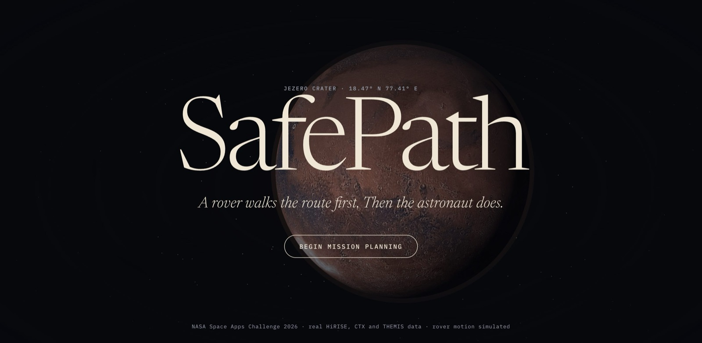
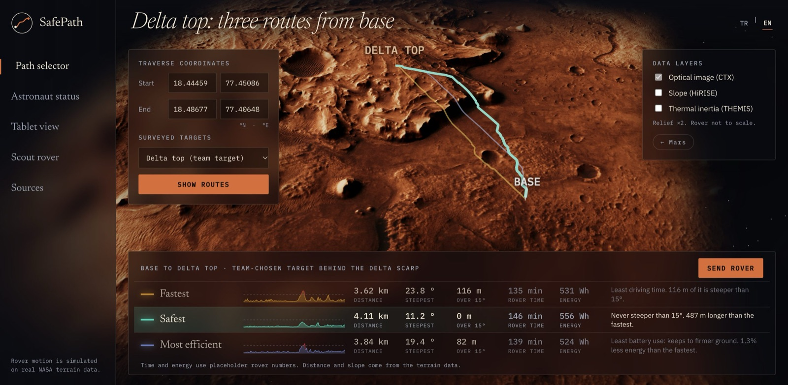

# SafePath (Türkçe özet)

**Önce rover, sonra insan.** NASA Space Apps Challenge 2026 için Jezero kraterinde
astronot yüzey keşfine yönelik katmanlı Mars haritası ve rota planlayıcı.

Asıl doküman İngilizce: [README.md](README.md). Bu dosya ekip için kısa bir rehberdir.



## Proje ne yapıyor

Astronot bir bilim hedefine yürümeden önce küçük bir öncü rover aynı yolu dener.
SafePath gerçek NASA arazi verisi üzerinde üç rota hesaplar (en hızlı, en güvenli,
en verimli), gidiş dönüş için rover bataryasını ve astronot oksijenini kontrol
eder; rover yörünge haritasında görünmeyen bir engelle karşılaşınca rotayı D* Lite
ile onarır.

## Siteyi kendi bilgisayarında açmak

1. Sayfanın üstündeki yeşil **Code** düğmesine bas, **Download ZIP** seç ve
   indirilen dosyayı aç.
2. Bilgisayarında Python yüklü olmalı. Terminali (Windows'ta Komut İstemi) proje
   klasöründe aç ve şunu yaz:

   ```
   python -m http.server 8765 --directory web
   ```

3. Tarayıcıda http://127.0.0.1:8765 adresine git.

`index.html` dosyasına çift tıklayarak açmak çalışmaz; tarayıcılar güvenlik
nedeniyle veri dosyalarını bu şekilde yüklemez. Yukarıdaki komut gerekli.

## Beş ekran

| Ekran | Ne gösterir |
|---|---|
| Patika seçici | Dönen Mars, koordinat girişi, Jezero'ya uçuş, 3B arazi, veri katmanları, üç rota, rover'ın gidiş dönüşü ve gizli engel |
| Astronot durumu | Giysi telemetrisi (benzetim, nefes sesiyle) ve seçilen rotanın sonunda kalan oksijen, batarya, radyasyon dozu |
| Tablet görüntüsü | Yol boyu min / ort / maks değerler, Jezero hava verisi, Perseverance'ın varış noktasında çektiği gerçek fotoğraf, risk göstergesi |
| Öncü rover | Kendi tasarımımız olan rover'ın 3B modeli ve ölçüleri |
| Kaynakça | Her veri kaynağı, ne için kullanıldığı ve linki; yapay zekâ kullanım beyanı |

Sağ üstteki **TR | EN** ile dil değişir.



## Jüri sorarsa: ne gerçek, ne benzetim

| Gerçek | Benzetim ya da varsayım |
|---|---|
| Arazi yüksekliği ve eğim (HiRISE, 5 m) | Rover'ın hareketi ve engeli algılaması |
| Uydu görüntüsü (CTX) ve zemin türü (THEMIS) | Gizli engelin yeri ve boyutu (biz yerleştiriyoruz) |
| D* Lite algoritması ve hesapladığı rotalar | Rover'ın kütlesi, hızı, bataryası (tasarım kesinleşmedi) |
| Bilim duraklarının koordinatları ve fotoğrafları (Perseverance) | Süre ve enerji sayıları (yukarıdaki varsayımlara bağlı) |
| Jezero hava sıcaklığı ve basıncı (MEDA) | Giysi telemetrisi (kalp ritmi, nefes) |
| Radyasyon ölçümleri (Curiosity, 2012–2026) | Görüntünün rengi (kamera tek bantlı, biz boyadık) |

Dikkat edilecek üç nokta:

- **Radyasyon Jezero'dan değil.** Perseverance'ta radyasyon dedektörü yok; ölçümler
  Curiosity'nin Gale kraterinden.
- **Rotalar tarayıcıda hesaplanmıyor.** Python motoru yedi hedef için önceden
  hesapladı; site sonuçları gösteriyor. Çizim animasyonu bir gösterimdir.
- **Mesafe ve eğim sayıları sağlam, süre ve enerji sayıları değil.** Sunumda süre
  ve enerjiyi sonuç olarak söylemeyin.

## Güçlü yanlarımız

- Haritamız doğrulandı: Perseverance'ın alanımızdaki 388 duruş noktasında NASA'nın
  kaydettiği yükseklik ile bizim ızgaramız arasındaki fark ortalama 1 cm, sapma 18 cm.
- D* Lite ölçüldü: gizli engel senaryosunda 36 onarım toplam 0,13 saniye, aynı
  noktadan baştan planlama 0,72 saniye.
- Üç bağımsız veri türü (yükseklik, optik, ısıl atalet) aynı haritada.
- Rover kendi tasarımımız; ölçüleri CAD modelinden.

## Klasörler

| Klasör | İçinde ne var |
|---|---|
| `web/` | Site (derleme gerektirmez) |
| `route/` | Rota motoru: D* Lite, üç rota, gizli engel senaryosu |
| `pipeline/` | Veriyi indirip işleyen betikler |
| `data/` | İşlenmiş veri ve sonuçlar |
| `tests/` | D* Lite testleri |
| `docs/images/` | Ekran görüntüleri |

## Değişiklik önermek

Repo'yu herkes görebilir ve indirebilir, ama yalnız Andaç değiştirebilir. Bir
düzeltme ya da ekleme istiyorsan dosyayı Drive'daki ortak klasöre koy ya da
Andaç'a yaz.
